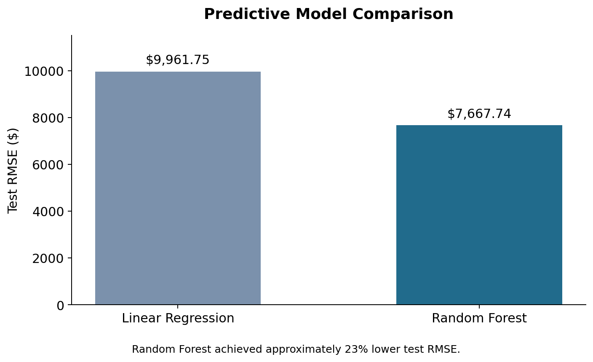
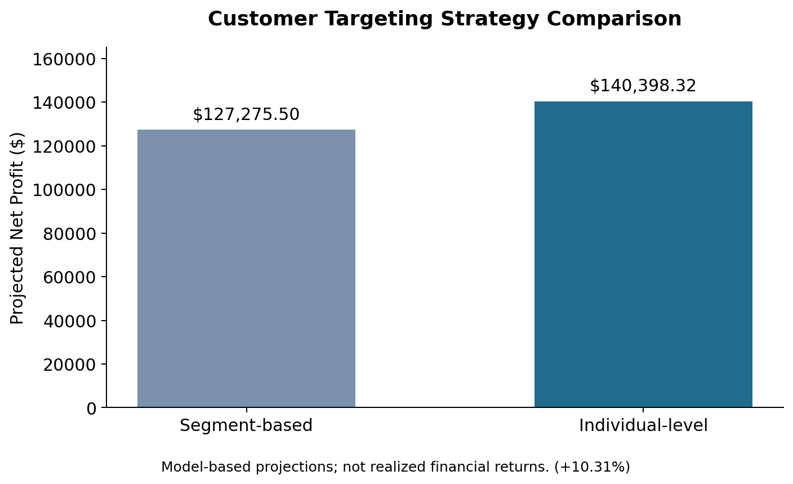

# Banking Customer Profitability & Predictive Analytics

## Project Overview
This project explores how a financial institution can improve customer targeting decisions using predictive analytics and expected value optimization. The objective was to identify customers with the highest projected financial value under a fixed marketing budget.

## Business Problem
Rather than selecting customers solely based on broad customer segments, the analysis evaluates whether individual-level predictive modeling can improve campaign profitability.

## Data & Methodology
- Analyzed 30,000 historical campaign records and evaluated targeting opportunities across 100,000 prospective customers.
- Compared Linear Regression and Random Forest models for predicting customer financial value.
- Estimated expected value using predicted response probabilities, predicted funding amounts, and campaign costs.
- Ranked prospective customers and selected the top 10,000 under a $15,000 campaign budget.
- Compared model-based targeting with a segment-based strategy.

## Key Results
| Metric | Result |
|---|---|
| Linear Regression Test RMSE | $9,961.75 |
| Random Forest Test RMSE | $7,667.74 |
| Reduction in prediction error | Approximately 23% |
| Projected net profit: model-based strategy | $140,398.32 |
| Projected net profit: segment-based strategy | $127,275.50 |
| Projected improvement | 10.31% |

## Business Recommendation
The analysis supports prioritizing individual-level, expected-value-based customer targeting over broad segment-based selection under the modeled assumptions. Random Forest provided stronger predictive performance in the test results, and the proposed targeting strategy generated higher projected net profit.

## Tools & Skills
Predictive Analytics · Random Forest · Linear Regression · Expected Value Analysis · Customer Segmentation · Financial Decision-Making

## Important Note
All profit figures are model-based projections, not realized business results. This portfolio summary does not include confidential customer-level data or restricted course assessment materials.

## Data Visualizations

### 1. Predictive Model Performance

Random Forest achieved approximately 23% lower test RMSE than Linear Regression.

### 2. Projected Profit Optimization

Individual-level targeting generated 10.31% higher projected net profit than segment-based targeting under the modeled assumptions. These figures are projections, not realized returns.

## Detailed Methodology

For a step-by-step explanation of the analytical process, see the [Analytical Workflow](methodology/analytical_workflow.md).
